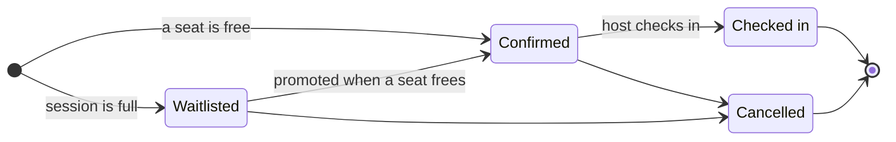
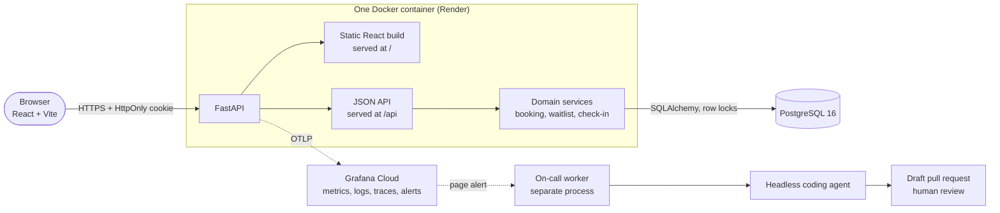
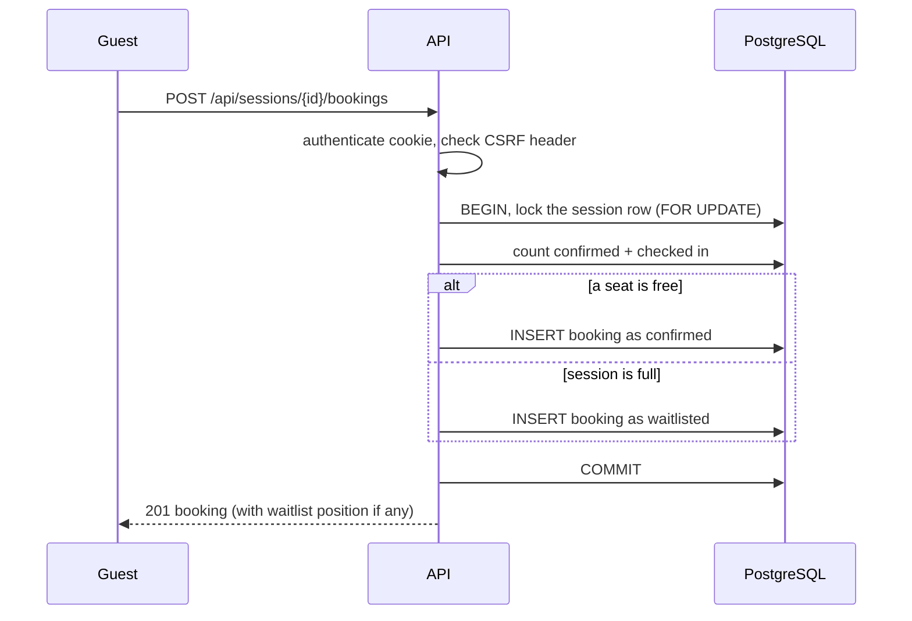
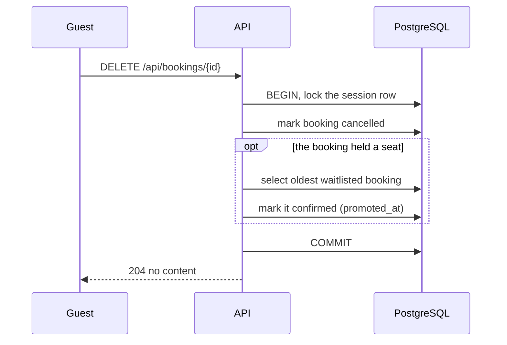
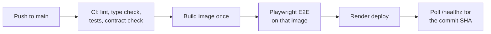

<div align="center">

# OpenSeat

**Fill every seat, without overbooking.**

A booking and waitlist app for small workshops: guests reserve a seat, join a
waitlist when it is full, and are promoted automatically when someone cancels.

[](https://github.com/maxxqcty/openseat/actions/workflows/ci.yml)


**[Live demo](https://openseat-9b15.onrender.com)** ·
**[Architecture](#architecture)** ·
**[Quick start](#quick-start)** ·
**[Issues](https://github.com/maxxqcty/openseat/issues)**

<sub>Free tier: the first request after idle takes about a minute to wake the service.</sub>

</div>

---

## Contents

[The problem](#the-problem) ·
[How it works](#how-it-works) ·
[Architecture](#architecture) ·
[Quick start](#quick-start) ·
[Tests](#tests) ·
[Deploying](#deploying) ·
[Observability and on-call](#observability-and-on-call) ·
[Project layout](#project-layout) ·
[Documentation](#documentation) ·
[Status](#status)

## The problem

Workshop hosts run sign-ups through group chats and spreadsheets. When someone
cancels, the host messages the next person by hand and a seat sits empty while
someone is waiting. Attendance lives on paper, or nowhere.

OpenSeat keeps the **roster**, the **waitlist** and the **check-in list** in one
place, and fills a cancelled seat on its own.

## How it works

| Role | What they can do |
| --- | --- |
| **Host** | Create and cancel sessions, watch the roster, check guests in |
| **Guest** | Browse sessions, book, join the waitlist, cancel, see their status |

```text
Host creates a session (capacity 1)
Guest A books      ->  Confirmed
Guest B books      ->  Waitlisted (position 1)
Guest A cancels    ->  Guest B is promoted automatically
Host checks B in   ->  Checked in (still holds the seat)
```

Every booking moves through these states:



**Highlights**

- **Race-safe capacity.** `confirmed + checked_in <= capacity` is enforced with a
  row lock, so concurrent bookings can never overbook a session.
- **Automatic promotion.** Cancelling frees a seat and promotes the oldest waiter
  in the same transaction, so a freed seat is never lost.
- **Check-in window.** Open from two hours before the start until the session ends.
- **Secure by default.** Argon2id passwords, HttpOnly cookie sessions, CSRF header
  on every mutation, and telemetry with personal data redacted.
- **Contract first.** `openapi.yaml` is checked against the app in CI.

Out of scope for v1: payments, email, recurring sessions, uploads, teams, seat maps.

## Architecture

OpenSeat is one web application. In production a **single container** serves the
built React app and the JSON API, so everything is same-origin and no CORS is
needed. PostgreSQL holds all state.



The on-call worker never deploys, merges, or touches production data.

### Booking a seat

The session row is locked before seats are counted, so two guests racing for the
last seat are serialised and exactly one wins; the other lands on the waitlist.



### Cancelling and promoting

Promotion is part of the cancellation transaction: if it fails, the cancellation
rolls back.



### Components

| Component | Responsibility | Location |
| --- | --- | --- |
| API routers | HTTP validation, auth, status codes | `backend/app/api/` |
| Domain services | Booking, waitlist, promotion and check-in rules | `backend/app/services/` |
| Models and schemas | SQLAlchemy mappings, Pydantic request/response types | `backend/app/models/`, `backend/app/schemas/` |
| Telemetry | OpenTelemetry providers, metrics, JSON logs, redaction | `backend/app/telemetry.py` |
| Frontend services | The only place that calls the API (`fetch`) | `frontend/src/services/` |
| Pages and components | Rendering and interaction | `frontend/src/pages/`, `frontend/src/components/` |
| On-call worker | Alert polling, evidence packet, agent launch | `on-call/` |
| CI/CD | Build once, E2E gate, guarded deploy, promote, rollback | `.github/workflows/` |

### Key decisions

| Decision | Why |
| --- | --- |
| One container for UI and API | Simple deploy, same origin, no CORS in production |
| Row lock per session | Correct capacity under concurrency; other sessions stay parallel |
| Cookie session with a CSRF header | No token in JavaScript, simple logout |
| Polling every 10 seconds | Avoids WebSocket infrastructure; up to 10 s of staleness |
| Build the image once in CI | The E2E suite and the deploy use the exact same bytes |
| Render free tier | Free Docker hosting and Postgres from a Blueprint in git |

The full write-up, with the data model, auth rules, CI/CD and the deviations from
the original plan, is in [`_docs/architecture.md`](_docs/architecture.md).

## Quick start

You need Python 3.12 with [uv](https://docs.astral.sh/uv/), Node.js 22+, GNU Make
(Git Bash or WSL on Windows), and Docker for the full stack.

```bash
cp .env.example .env          # Windows PowerShell: Copy-Item .env.example .env
make install
make dev
```

| What | Where |
| --- | --- |
| Frontend | <http://localhost:5173> |
| API | <http://localhost:8091> (docs at `/docs`, health at `/healthz`) |

`make dev` needs a running PostgreSQL and `DATABASE_URL` in `.env` (see
`.env.example`). To run everything, Postgres included, with one command:

```bash
docker compose up --build     # app at http://localhost:8080
```

**Demo data** (development only):

```bash
make seed          # demo users, sessions and bookings
make seed-reset    # remove the seeded rows, then recreate them
```

Seeded accounts share the password `openseat-dev-password`:
`host@example.com`, `guest-a@example.com`, `guest-b@example.com`.

## Tests

```bash
make test    # backend unit + integration, frontend unit
make e2e     # Playwright: a host and two guests against the Compose stack
make lint    # ruff, mypy, eslint, tsc
```

| Layer | Tools |
| --- | --- |
| Backend | pytest, httpx, a real PostgreSQL for integration and race tests |
| Frontend | Vitest, React Testing Library |
| End to end | Playwright, three isolated browser contexts |

Strategy and fixtures are in [`_docs/testing.md`](_docs/testing.md).

## Deploying

The demo runs on [Render](https://render.com) (one free web service and one free
Postgres) from [`render.yaml`](render.yaml). Every push to `main` runs CI, then the
E2E suite against the built image, and only then deploys.



```bash
make render-validate                                       # check render.yaml offline
make render-verify URL=https://openseat-9b15.onrender.com  # smoke-test the live demo
```

Free-tier caveats: the service sleeps after 15 minutes idle, and the free
database **expires 30 days after creation**. Setup, the deploy hook, promotion and
rollback are in [`deploy/render/README.md`](deploy/render/README.md).

## Observability and on-call

- **Telemetry:** OpenTelemetry traces, metrics and structured JSON logs that share
  a trace ID. Export is off until `OTEL_EXPORTER_OTLP_ENDPOINT` is set, so local
  runs and tests need no Grafana account.
- **Dashboard and alerts:** [`observability/`](observability/README.md) holds the
  Grafana dashboard and five page alerts, each with an owner, dashboard link and
  [runbook](_docs/runbook.md) entry.
- **On-call worker:** polls Grafana, builds a redacted evidence packet, and runs a
  headless coding agent in an isolated worktree that opens a **draft PR** for a
  human to review. It cannot merge or deploy. See [`on-call/`](on-call/README.md).

## Project layout

```text
backend/          FastAPI app, domain services, migrations, tests
frontend/         React app, services layer, tests
e2e/              Playwright tests
on-call/          alert worker and chaos helper
observability/    Grafana dashboard, alert rules, setup guide
deploy/           Render deployment notes
scripts/          dev runner, contract check, Render and E2E helpers
_docs/            spec, architecture, testing, runbook, security, evidence
openapi.yaml      the canonical API contract
render.yaml       Render Blueprint
```

## Documentation

| Topic | Where |
| --- | --- |
| Product scope and rules | [`_docs/spec.md`](_docs/spec.md) |
| Architecture and decisions | [`_docs/architecture.md`](_docs/architecture.md) |
| Testing strategy | [`_docs/testing.md`](_docs/testing.md) |
| Alert runbook | [`_docs/runbook.md`](_docs/runbook.md) |
| Security audit | [`_docs/security.md`](_docs/security.md) |
| Evidence and rubric | [`_docs/evidence/README.md`](_docs/evidence/README.md), [`_docs/RUBRIC.md`](_docs/RUBRIC.md) |
| Backlog and process | [`_docs/backlog.md`](_docs/backlog.md), [`_docs/process.md`](_docs/process.md) |

## Status

v1.0.0 is implemented. Evidence that needs a Grafana account, a live chaos run, a
recording or reviewers (dashboard screenshots, the on-call draft PR, the demo
video, peer reviews) is still **pending**; it is tracked in
[`_docs/evidence/README.md`](_docs/evidence/README.md) and not claimed as done.
